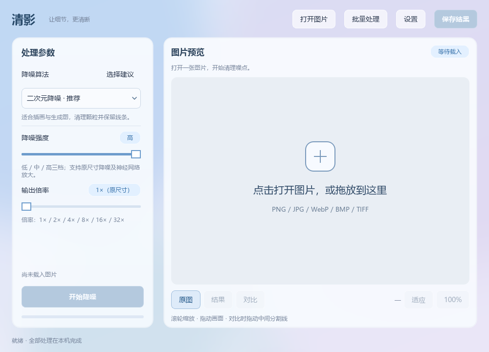

# 清影 · 图片降噪

在本机清理图片噪点、保留边缘与细节。提供 **Windows** 和 **Android** 两个版本，中文界面、六种算法、原图与结果对比，处理过程不上传图片。

**Android 1.0.0** · **Windows 2.5**

## 下载

| 平台 | 系统要求 | 下载 |
| --- | --- | --- |
| Android | Android 7.0+，64 位 ARM 手机 | [下载 APK](https://github.com/qingfengweiliang/qingying-image-denoiser/releases/download/android-v1.0.0/Qingying-Android-1.0.0.apk) · [版本说明](https://github.com/qingfengweiliang/qingying-image-denoiser/releases/tag/android-v1.0.0) |
| Android 完整交付包 | APK、源码、构建与 GitHub 上传说明 | [下载 ZIP](https://github.com/qingfengweiliang/qingying-image-denoiser/releases/download/android-v1.0.0/Qingying-Android-1.0.0.zip) |
| Windows | Windows x64 | [下载 ZIP](https://github.com/qingfengweiliang/qingying-image-denoiser/releases/download/V2.5.0/Qingying-2.5-Windows-x64.zip) · [版本说明](https://github.com/qingfengweiliang/qingying-image-denoiser/releases/tag/V2.5.0) |

安卓下载 APK 后安装，按系统提示允许当前浏览器或文件管理器“安装未知应用”。不支持 32 位安卓设备。

Windows 下载后**完整解压**，运行 `清影图片降噪.exe`，保留同目录的 `_internal` 文件夹；打包版不需要另装 Python。

## 安卓版

1. 打开图片，选择算法、强度和输出倍率。
2. 点击“开始降噪”，处理时保持应用打开。
3. 切换“原图 / 结果 / 分割对比”；双指缩放、拖动画面或分割线，双击复位。
4. 点击“保存结果”，导出 PNG、JPEG 或 WebP 到系统文件选择器指定的位置。

六种算法均在手机本地运行。两种 AI 引擎使用 CPU，不要求手机支持 Vulkan；大图及放大处理可能较慢。首版面向**单张图片，最高 4× 放大**，不含批量处理和任务取消。输入上限 1600 万像素，处理上限还会按算法和设备内存收紧。

[安卓源码与构建说明](android/README.md) · [Android 1.0.0 更新说明](docs/releases/android-v1.0.0.md) · [构建与验证记录](docs/android-validation.md)

已通过模拟器端到端测试、核心模型回归、Release 构建、Lint 与签名检查；**尚未进行 ARM64 实体手机测试**，不同机型的性能与内存兼容性仍需反馈。

## 算法与平台差异

| 算法 | 适用场景 | Android | Windows |
| --- | --- | --- | --- |
| Waifu2x CUNet | 插画、生成图颗粒清理 | 1 / 2 / 4×，CPU | 1 / 2 / 4 / 8 / 16 / 32×，Vulkan |
| Real-CUGAN | 线条与纹理重建 | 1 / 2 / 3 / 4×，CPU | 1 / 2 / 3 / 4×，Vulkan |
| AI Image Rehab | 生成图杂纹清理 | 1× | 1× |
| 非局部均值 | 普通照片噪点 | 1× | 1× |
| 双边滤波 | 轻度噪点、快速处理 | 1× | 1× |
| 中值滤波 | 黑白颗粒、椒盐噪声 | 1× | 1× |

Real-CUGAN 的 1× 会先以 2× 重建再缩回；3×、4× 模型仅提供高强度。Windows 预计输出超过 6000 万像素会被阻止；安卓采用更适合手机内存的限制。

降噪可能损失纹理或改变细节，不能恢复已丢失的信息。图片按常规 8 位 RGB/RGBA 处理，不支持相机 RAW；导出不保留原始 EXIF、GPS、ICC 等元数据。JPEG 将透明区域合成为白色背景。

## Windows 界面与使用



打开图片或拖入预览区，选择算法、强度和倍率后开始处理。可切换原图、结果与分割对比，滚轮缩放、拖动平移，“100%”检查实际像素，“适应”回到全图。顶部提供批量处理；保存支持 PNG、JPG、WebP。

Windows 的 Waifu2x 和 Real-CUGAN 需要支持 Vulkan 的显卡及驱动，其他算法使用 CPU。

## 从源码构建

### Android

需要 JDK 17、Python 3.10、Android SDK 35、NDK 27.2.12479018 和 CMake 3.22.1。完整步骤见 [android/README.md](android/README.md)。

```sh
cd android
python scripts/prepare_ncnn.py
./gradlew :app:assembleDebug
```

Windows 使用 `gradlew.bat`。GitHub [Android APK 工作流](../../actions/workflows/android.yml) 可自动构建测试包。正式更新必须使用同一签名密钥，并增加 `versionCode`；私密密钥及密码不要上传仓库。

### Windows

Windows 版本在 Python 3.14 x64 上构建并测试。仓库保存界面与处理源码、许可和模型参数；原生 EXE、DLL 与 Windows 模型权重随 Release 提供。

```powershell
python scripts/restore_native.py "Qingying-2.5-Windows-x64.zip"
python -m venv .venv
.\.venv\Scripts\python.exe -m pip install -r requirements.txt
.\.venv\Scripts\python.exe app.py
```

打包：

```powershell
.\.venv\Scripts\python.exe -m pip install pyinstaller
.\.venv\Scripts\python.exe -m PyInstaller --noconfirm build.spec
```

输出位于 `dist/清影图片降噪/`。对外分享时一并附上 `licenses/` 和 `docs/使用说明.txt`，完整压缩该目录。

## 第三方组件与许可

使用 [waifu2x-ncnn-vulkan](https://github.com/nihui/waifu2x-ncnn-vulkan)、[realcugan-ncnn-vulkan](https://github.com/nihui/realcugan-ncnn-vulkan)、[AI Image Rehab](https://github.com/BlairKaiser/ai-image-rehab)、ncnn、OpenCV、NumPy、SciPy、Pillow；Windows 界面使用 PySide6/Qt，安卓使用原生界面与 Chaquopy。

第三方引擎、代码和模型保留原作者许可与来源说明，见 `licenses/`、`native/`、`third_party/` 及 [安卓组件说明](android/app/src/main/assets/licenses/NOTICE.txt)。安卓应用内点击标题旁的 ⓘ 可查看许可。

本仓库尚未为原创代码指定独立开源许可证；公开可见不等于授权任意再分发。详情见 [使用说明](docs/使用说明.txt)。
