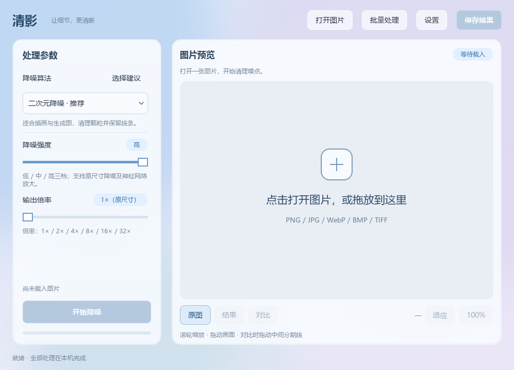

# 清影 · 图片降噪

在本机清理图片噪点、保留边缘与细节。面向 Windows 桌面端，中文界面、六种算法、原图与结果对比，处理过程不上传图片。

## 下载

下载 Windows 安装包，完整解压后即可使用。

| 平台 | 已发布版本 | 运行要求 | 安装包与说明 |
| --- | --- | --- | --- |
| Windows | 2.5 | Windows x64；两种 AI 算法需要 Vulkan 显卡及驱动 | [下载 ZIP](https://github.com/qingfengweiliang/qingying-image-denoiser/releases/download/V2.5.0/Qingying-2.5-Windows-x64.zip) · [版本说明](https://github.com/qingfengweiliang/qingying-image-denoiser/releases/tag/V2.5.0) |

更多说明见 [文档导航](docs/README.md)。

## Windows 使用



完整解压 ZIP，运行 `清影图片降噪.exe`，保留同目录的 `_internal` 文件夹；打包版不需要另装 Python。打开图片或拖入预览区，选择算法、强度和倍率后开始处理。

支持批量处理、原图 / 结果 / 分割对比、滚轮缩放、拖动平移、“100%”像素查看，以及 PNG / JPG / WebP 保存。Waifu2x 和 Real-CUGAN 需要支持 Vulkan 的显卡及驱动，其余算法使用 CPU。

## 算法

| 算法 | 适用场景 | 倍率与运行方式 |
| --- | --- | --- |
| Waifu2x CUNet | 插画、生成图颗粒清理 | 1 / 2 / 4 / 8 / 16 / 32×，Vulkan |
| Real-CUGAN | 线条与纹理重建 | 1 / 2 / 3 / 4×，Vulkan |
| AI Image Rehab | 生成图杂纹清理 | 1×，CPU |
| 非局部均值 | 普通照片噪点 | 1×，CPU |
| 双边滤波 | 轻度噪点、快速处理 | 1×，CPU |
| 中值滤波 | 黑白颗粒、椒盐噪声 | 1×，CPU |

Real-CUGAN 的 1× 会先以 2× 重建再缩回；3×、4× 模型仅提供高强度。预计输出超过 6000 万像素会被阻止。

降噪可能损失纹理或改变细节，不能恢复已丢失的信息。图片按常规 8 位 RGB/RGBA 处理，不支持相机 RAW；导出不保留原始 EXIF、GPS、ICC 等元数据。JPEG 将透明区域合成为白色背景。

## 从源码构建


Windows 版本在 Python 3.14 x64 上构建并测试。仓库保存界面与处理源码、许可和模型参数；原生 EXE、DLL 与 Windows 模型权重随 Release 提供。

```powershell
python scripts/restore_native.py "Qingying-2.5-Windows-x64.zip"
python -m venv .venv
.\.venv\Scripts\python.exe -m pip install -r requirements.txt
.\.venv\Scripts\python.exe app.py
```

打包：

```powershell
.\.venv\Scripts\python.exe -m pip install pyinstaller
.\.venv\Scripts\python.exe -m PyInstaller --noconfirm build.spec
```

输出位于 `dist/清影图片降噪/`。对外分享时一并附上 `licenses/` 和 `docs/使用说明.txt`，完整压缩该目录。

## 仓库导航

| 路径 | 内容 |
| --- | --- |
| `app.py`、`glass_ui.py`、`engine.py` | Windows 启动入口、界面和处理逻辑 |
| `docs/` | 使用说明、截图和文档导航 |
| `native/`、`third_party/`、`licenses/` | 引擎资料、第三方算法、来源和许可证 |
| `scripts/` | 本地辅助脚本 |

安装包从上方下载入口获取；更详细的说明统一从 [文档导航](docs/README.md) 查找。

## 第三方组件与许可


使用 [waifu2x-ncnn-vulkan](https://github.com/nihui/waifu2x-ncnn-vulkan)、[realcugan-ncnn-vulkan](https://github.com/nihui/realcugan-ncnn-vulkan)、[AI Image Rehab](https://github.com/BlairKaiser/ai-image-rehab)、ncnn、OpenCV、NumPy、SciPy、Pillow；Windows 界面使用 PySide6/Qt。

第三方引擎、代码和模型保留原作者许可与来源说明，见 `licenses/`、`native/`、`third_party/`。

本仓库尚未为原创代码指定独立开源许可证；公开可见不等于授权任意再分发。详情见 [使用说明](docs/使用说明.txt)。
